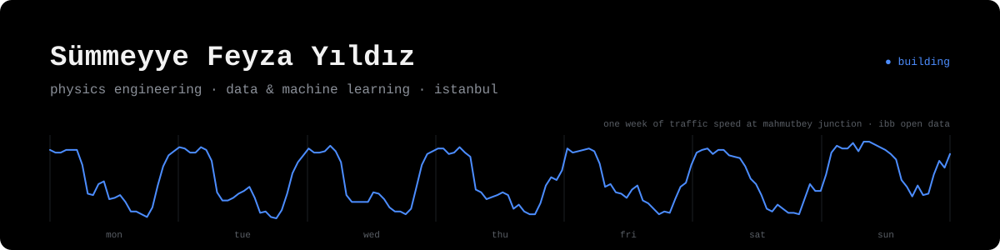
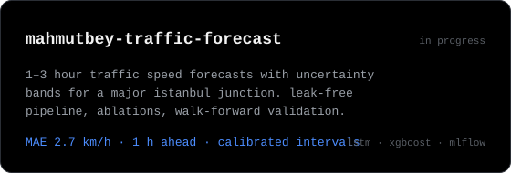
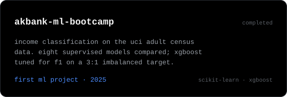

<br>

Physics engineering student at İstanbul Medeniyet University.
I work with real-world data, mostly time series from Istanbul, and like turning them into forecasts that are honest about their uncertainty.

```text
now      → forecasting traffic speed at mahmutbey junction, 1–3 hours ahead
learning → mlops: docker, mlflow, ci/cd
next     → data engineering on istanbul's live bus data
```

<br>

<p>
  <a href="https://github.com/sfeyzayildiz/mahmutbey-traffic-forecast"></a>
  <a href="https://github.com/sfeyzayildiz/Akbank-Makine-Ogrenmesi-Bootcamp"></a>
</p>

<br>

<sub><code>python · pandas · tensorflow · xgboost · scikit-learn · mlflow · docker · git</code></sub>
