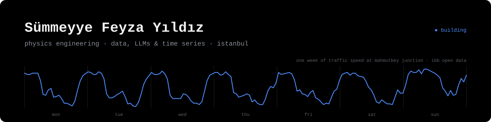
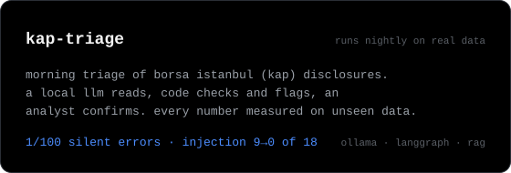
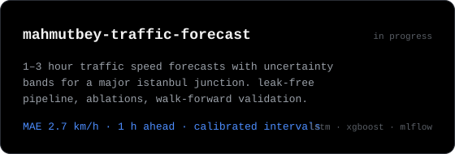
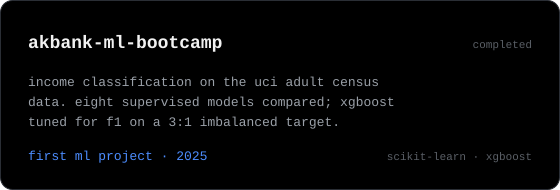

 

Physics engineering student at İstanbul Medeniyet University.
Interested in real-world data, local LLMs and time series, and especially in one question: how do we know a model's answer is right?

 

  
  

  

→ <a href="https://mahmutbey-traffic.streamlit.app">live demo: mahmutbey traffic forecast</a>

 

<code>python · pandas · tensorflow · xgboost · scikit-learn · mlflow · ollama · langgraph · fastapi · duckdb · docker · git</code>
